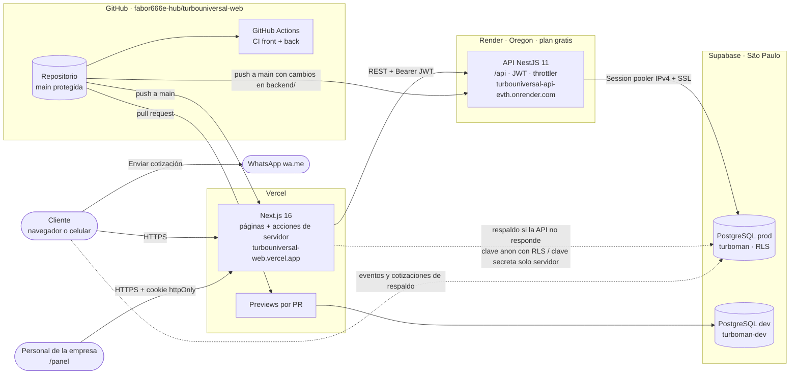

# Arquitectura

## Visión general
Navegador → Next.js en Vercel (páginas + acciones de servidor) → API REST NestJS en Render → PostgreSQL en Supabase.
Si la API no responde, el front lee y escribe directo en Supabase (con RLS), y si Supabase tampoco responde, muestra los datos locales.
Publicación: GitHub (PR + CI) → Vercel (front) y Render (API).

> Stack del diplomado: Next.js + Spring Boot + MySQL + AWS. Se usa la alternativa que permite la guía (Vercel, Supabase y, para el backend, NestJS en Render por indicación del profesor). La tabla "Equivalentes en AWS" muestra cómo se movería cada pieza. Ver docs/decisiones.md.

## Arquitectura desplegada



| Pieza | Servicio | Región | Plan | URL |
|---|---|---|---|---|
| Front (páginas, acciones de servidor) | Vercel | global (CDN) | Hobby | https://turbouniversal-web.vercel.app |
| API REST | Render Web Service (Node 22) | Oregon | Free (se duerme a los 15 min) | https://turbouniversal-api-evth.onrender.com/api |
| Base de datos producción | Supabase PostgreSQL | sa-east-1 (São Paulo) | Free | proyecto `turboman` |
| Base de datos desarrollo y previews | Supabase PostgreSQL | sa-east-1 | Free | proyecto `turboman-dev` |
| CI | GitHub Actions | — | Free | `.github/workflows/ci.yml` |

### Equivalentes en AWS
| Hoy | En AWS | Notas |
|---|---|---|
| Vercel (Next.js, CDN, previews) | **AWS Amplify Hosting** (o CloudFront + Lambda con OpenNext) | Amplify también crea un entorno por rama o PR. |
| Render Web Service (API NestJS) | **AWS App Runner** o **ECS Fargate** detrás de un Application Load Balancer | Con un contenedor Docker de `backend/`; Elastic Beanstalk es otra opción sencilla. |
| Supabase PostgreSQL | **Amazon RDS for PostgreSQL** (o Aurora PostgreSQL Serverless v2) | RLS es de PostgreSQL y funciona igual; la API ya usa `DATABASE_URL`. |
| Supabase dev / prod | Dos instancias RDS o dos cuentas/entornos de AWS | Igual separación que hoy. |
| Variables de entorno de Vercel y Render | **AWS Secrets Manager** y **SSM Parameter Store** | Las claves no viven en el código. |
| GitHub Actions | GitHub Actions con OIDC hacia AWS, o **CodePipeline + CodeBuild** | El mismo `ci.yml` puede desplegar. |
| Registros de Vercel y Render | **Amazon CloudWatch Logs** y alarmas | |
| Dominio y HTTPS automáticos | **Route 53** + **AWS Certificate Manager** | |
| Límite de peticiones (throttler) | **AWS WAF** con reglas de tasa (además del de la API) | |

## Front
- Next.js 16 (App Router), React 19, TypeScript, Tailwind CSS 4.
- Componentes de servidor leen datos; componentes de cliente (`"use client"`) manejan la interacción.
- Datos de prueba (mock): `data/productos.ts`. Si Supabase no responde, el sitio usa estos datos y no se cae.
- Estado de la cotización: React Context (`app/components/Cotizacion.tsx`) guardado en `localStorage`.

## Back
- API NestJS en `backend/` (sección "Backend (U4)" más abajo) y Supabase (PostgreSQL) con políticas RLS.
- Reglas de negocio del front sin React (para probarlas): `lib/reglas.ts`.
- Lectura: `lib/datos.ts` (`obtenerProductos`, `obtenerProducto`).
- Rastreo: `lib/rastreo.ts` (`registrar`, `guardarCotizacion`).
- Escrituras del administrador: acciones de servidor en `app/panel/productos/acciones.ts` con `lib/supabaseAdmin.ts` (clave secreta, solo servidor) y sesión verificada con `lib/sesionPanel.ts`.

## Estructura
```
app/
  layout.tsx · page.tsx · loading.tsx · not-found.tsx
  productos/ · productos/[referencia]/      F1
  asistente/                                F3
  panel/ · panel/productos/                 F4 · F5
  nosotros/ · marcas/ · puntos-de-venta/    Páginas de apoyo
  prototipo/a · /b · /c                     Variantes de la pantalla principal
  components/                               Componentes en PascalCase
lib/        api.ts · apiAdmin.ts · datos.ts · rastreo.ts · reglas.ts · supabase.ts · supabaseAdmin.ts · sesionPanel.ts · utils.ts
data/       productos.ts (tipos, categorías y datos mock)
public/     logo, logos de marcas, fotos de Nosotros
docs/       planos del proyecto (este directorio)
tests/      unit/ (reglas de negocio) · e2e/ (F1–F3, regla crítica, acceso cruzado)
.github/    workflows/ci.yml (integración continua)
```

## Datos
Entidades: **Producto**, **Evento**, **Cotización**.
- Producto 1—N ítems de Cotización (guardados como JSON dentro de la cotización).
- Producto 1—N Eventos (vistas y "agregar a cotización" referencian la referencia del producto).

| Tabla | Campos | RLS para el visitante |
|---|---|---|
| `productos` | referencia (PK), nombre, marca, categoria, vehiculos text[], precio int, stock int, imagen | Solo leer |
| `eventos` | id, tipo, detalle, creado_en | Solo insertar |
| `cotizaciones` | id, nombre, telefono, items jsonb, total, creado_en | Solo insertar |

Tipos de evento: `vista_producto`, `busqueda`, `categoria`, `clic`, `agregar_cotizacion`, `asistente`, `video`.

## Variables de entorno (`.env.local`, nunca en GitHub)
| Variable | Uso | Secreta |
|---|---|---|
| `NEXT_PUBLIC_SUPABASE_URL` | URL del proyecto | No |
| `NEXT_PUBLIC_SUPABASE_ANON_KEY` | Lectura pública limitada por RLS | No |
| `SUPABASE_SERVICE_ROLE_KEY` | Panel y administrador (solo servidor) | Sí |
| `PANEL_CLAVE` | Contraseña del panel (igual a la de Render) | Sí |
| `NEXT_PUBLIC_API_URL` | URL de la API, ej. `https://turbouniversal-api-evth.onrender.com/api` | No |

## Servicios externos
WhatsApp (`wa.me`), Google Maps (iframe), Flipsnack (catálogo anterior), Instagram y Facebook.

## Despliegue
Ver docs/operacion/despliegue.md (entornos, variables por entorno, flujo PR → preview → producción, rollback e incidentes).
- Front y acciones de servidor: Vercel, proyecto `turbouniversal-web` (https://turbouniversal-web.vercel.app).
- API: Render, servicio `turbouniversal-api-evth`.
- Base de datos: Supabase `turboman` (producción) y `turboman-dev` (desarrollo y previews). El plan gratis se pausa por inactividad.

## Calidad
- Pruebas unitarias de las reglas de negocio (`lib/reglas.ts`) y e2e de F1–F3 con Playwright: `npm test` y `npm run e2e`.
- Pruebas de la API contra PostgreSQL real: `cd backend && npm test`.
- CI en cada PR y en `main`; `main` protegida. Auditoría e interventoría: docs/calidad/interventoria.md.

## Backend (U4) · API REST en Render
> Contrato completo: docs/contratos/api.md · Specs: docs/specs/B1 a B5.

```
Navegador ──► Next.js (Vercel) ──► API NestJS (Render) ──► PostgreSQL
                                     /api/...                (Supabase, proyecto "turboman")
```

| Capa | Tecnología | Dónde |
|---|---|---|
| API REST | NestJS 11 + TypeScript (Node 22) | `backend/` → Render (Web Service) |
| Acceso a datos | TypeORM + driver `pg` | `backend/src/**/*.entity.ts` |
| Base de datos | PostgreSQL | Supabase (Session pooler con SSL); se puede cambiar a otra base con `DATABASE_URL` |
| Validación | class-validator | DTOs en `backend/src/**/dto/` |
| Autenticación | JWT (8 h) firmado con `JWT_SECRETO` | `POST /api/auth/login` |
| Límite de peticiones | @nestjs/throttler | eventos y login |

### Estructura de `backend/`
```
backend/
  src/
    main.ts                 arranque, CORS, prefijo /api, validación global
    app.module.ts           conexión a PostgreSQL y módulos
    comun/                  filtro de errores con el formato del contrato, utilidades
    productos/              B1 + B4: entidad, DTOs, servicio, controlador
    cotizaciones/           B2
    eventos/                B3
    panel/                  B3: resumen para el administrador
    auth/                   B4: login y guardia JWT
    base-de-datos/          migración inicial y semilla con los 12 productos
  test/                     pruebas de cada criterio contra PostgreSQL real
  render.yaml               despliegue en Render (Blueprint)
```

### Variables de entorno del backend
| Variable | Uso | Secreta |
|---|---|---|
| `DATABASE_URL` | Conexión a PostgreSQL | Sí |
| `JWT_SECRETO` | Firma de los tokens del panel | Sí |
| `PANEL_CLAVE` | Clave del administrador | Sí |
| `ORIGEN_FRONT` | Dominio permitido por CORS (ej. https://turboman-web.vercel.app) | No |
| `PORT` | Puerto (Render lo asigna) | No |

### Conexión del front con la API (tarea 4.11)
- `lib/api.ts`: cliente de la API (`NEXT_PUBLIC_API_URL`), con tiempo límite y errores del contrato.
- `lib/datos.ts`: lee productos de la API (espera 4 s, caché de 60 s con la etiqueta `productos`); si no responde, lee Supabase y, si tampoco, los datos locales.
- `lib/rastreo.ts`: eventos y cotizaciones van a `POST /api/eventos` y `POST /api/cotizaciones` (con `aceptaDatos`, Ley 1581); si la API no responde, se guardan directo en Supabase.
- `lib/apiAdmin.ts` (solo servidor): inicia sesión con `PANEL_CLAVE` y reutiliza el token de 8 h. Lo usan el panel (`GET /api/panel/resumen`, `GET /api/cotizaciones`) y las acciones del administrador.
- El panel muestra de dónde salieron los datos: "API en Render → Supabase" o "Supabase directo".
- `PANEL_CLAVE` debe ser la misma en Vercel y en Render.
