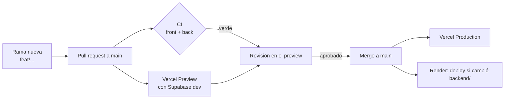

# Despliegue y operación (runbook)

Cómo se publica Turbo Universal, cómo se prueba un cambio antes de producción, cómo se vuelve atrás y qué hacer cuando algo falla.

## 1. Entornos

| | Desarrollo (local) | Preview (cada PR) | Producción |
|---|---|---|---|
| Front | `npm run dev` en `localhost:3000` | Vercel, URL única por PR (`turbouniversal-…-fabor666e-hub.vercel.app`) | Vercel, https://turbouniversal-web.vercel.app |
| API | `npm run dev` en `backend/` (puerto 4000) o ninguna | Ninguna: el preview no usa la API | Render, https://turbouniversal-api-evth.onrender.com/api |
| Base de datos | Supabase **dev** (`turboman-dev`) | Supabase **dev** (`turboman-dev`) | Supabase **prod** (`turboman`, sa-east-1) |
| Rama | cualquiera | rama del PR | `main` (protegida) |

Regla: **un preview nunca escribe en la base de producción.** Por eso Preview y Development usan Supabase dev y no tienen `NEXT_PUBLIC_API_URL` (la API de Render está conectada a producción).

### Variables por entorno en Vercel
Vercel → proyecto `turbouniversal-web` → Settings → Environments → (Production / Preview / Development) → Environment Variables.

| Variable | Production | Preview | Development | Tipo |
|---|---|---|---|---|
| `NEXT_PUBLIC_SUPABASE_URL` | URL de `turboman` | URL de `turboman-dev` | URL de `turboman-dev` | Config |
| `NEXT_PUBLIC_SUPABASE_ANON_KEY` | clave publicable de `turboman` | clave de `turboman-dev` | clave de `turboman-dev` | Config |
| `SUPABASE_SERVICE_ROLE_KEY` | clave secreta de `turboman` | clave secreta de `turboman-dev` | clave secreta de `turboman-dev` | Secret |
| `PANEL_CLAVE` | igual a la de Render | otra clave (de pruebas) | otra clave (de pruebas) | Secret |
| `NEXT_PUBLIC_API_URL` | `https://turbouniversal-api-evth.onrender.com/api` | *(vacía)* | *(vacía)* | Config |

Para trabajar en local: `npx vercel env pull .env.local` descarga las de Development (o copiarlas a mano en `.env.local`, que nunca se sube a GitHub).

### Variables de la API en Render (solo producción)
Render → `turbouniversal-api-evth` → Environment.

| Variable | Valor |
|---|---|
| `DATABASE_URL` | URI del **Session pooler** de Supabase `turboman` (usuario `postgres.yfmtvqfnirtobbyycldz`, host `…pooler.supabase.com`). La conexión directa no sirve: es solo IPv6. |
| `DATABASE_SSL` | `true` |
| `JWT_SECRETO` | generado por Render |
| `PANEL_CLAVE` | igual a la de Vercel Production |
| `ORIGEN_FRONT` | `https://turbouniversal-web.vercel.app,https://turboman-web.vercel.app,http://localhost:3000` |
| `NODE_VERSION` | `22` |

### Supabase dev y prod
1. Supabase → New project → nombre `turboman-dev`, misma región (São Paulo).
2. SQL Editor de `turboman-dev` → pegar y ejecutar [`esquema-supabase.sql`](esquema-supabase.sql). Crea las 3 tablas igual que en producción, sus políticas RLS y los 12 productos de ejemplo.
3. Copiar URL y claves de `turboman-dev` a las variables Preview y Development de Vercel.

### Redirect URLs (Supabase → Authentication → URL Configuration)
El MVP no tiene cuentas de clientes (está fuera del alcance en docs/producto.md), pero se dejan configuradas para que ningún correo o enlace de Supabase lleve a un dominio ajeno:

| Proyecto | Site URL | Redirect URLs |
|---|---|---|
| `turboman` (prod) | `https://turbouniversal-web.vercel.app` | `https://turbouniversal-web.vercel.app/**` |
| `turboman-dev` | `http://localhost:3000` | `http://localhost:3000/**` · `https://*-fabor666e-hub.vercel.app/**` |

## 2. Flujo de un cambio: PR → preview → producción

1. Crear una rama: `git checkout -b feat/nombre-del-cambio`.
2. Hacer el cambio, probar en local (`npm run dev`, `npm test`, `npm run e2e`) y subir: `git push -u origin feat/nombre-del-cambio`.
3. En GitHub, abrir el **Pull request** hacia `main`. Aparecen dos revisiones:
   - **CI** (GitHub Actions): `Front · lint, tipos, unitarias, build y e2e` y `Back · pruebas de la API contra PostgreSQL`.
   - **Vercel**: comenta en el PR la URL del preview.
4. Abrir el preview y revisar el cambio (a 390 px y en escritorio).
5. Si el CI está en verde y el preview se ve bien → **Merge pull request**. Con eso Vercel publica en producción y, si el PR tocó `backend/`, Render vuelve a desplegar la API.
6. Comprobar producción: `https://turbouniversal-web.vercel.app` y `…/api/salud`.

### Rama `main` protegida
GitHub → Settings → Branches (o Rules → Rulesets) → Add rule para `main`:
- ✅ Require a pull request before merging.
- ✅ Require status checks to pass: `Front · lint, tipos, unitarias, build y e2e` y `Back · pruebas de la API contra PostgreSQL`.
- ✅ Require branches to be up to date before merging.
- ✅ Block force pushes · ✅ Restrict deletions.

Desde ese momento nadie (ni el dueño) sube directo a `main`: todo pasa por PR y CI.

## 3. Rollback

### Front (Vercel) · menos de 1 minuto
1. Vercel → proyecto → **Deployments**.
2. Buscar el último despliegue de producción que funcionaba (marca "Ready").
3. Menú **⋯ → Instant Rollback** (o **Promote to Production**). No recompila: cambia el dominio al despliegue anterior.
4. Comprobar la URL de producción.
5. Corregir en una rama nueva y volver a hacer el flujo de PR. (Con un rollback activo, Vercel no promueve solos los siguientes despliegues de `main` hasta que se vuelva a promover uno.)

### API (Render) · 1 a 2 minutos
1. Render → `turbouniversal-api-evth` → **Deploys**.
2. En el despliegue anterior que estaba "Live", pulsar **Rollback**.
3. Comprobar `…/api/salud` → `{"estado":"ok","baseDeDatos":"ok"}`.

### Base de datos
- Las migraciones de `backend/src/base-de-datos/migraciones/` solo agregan (`CREATE TABLE IF NOT EXISTS`); un rollback del código no borra datos.
- Si se dañan datos: Supabase → Database → Backups (plan gratis: copias diarias de los últimos días) o restaurar desde un `pg_dump` hecho antes del cambio.
- Antes de un cambio de esquema: `pg_dump "<DATABASE_URL>" > respaldo-AAAA-MM-DD.sql`.

### Alternativa con Git
`git revert <commit>` en una rama → PR → merge. Deja el historial limpio y pasa por CI.

## 4. Incidentes frecuentes

| Síntoma | Causa probable | Qué hacer |
|---|---|---|
| El panel dice "Supabase directo (la API no respondió)" | La API de Render está dormida (plan gratis, ~50 s para despertar) | Abrir `…/api/salud`, esperar y recargar. El sitio sigue funcionando con Supabase directo. |
| Render: `ENETUNREACH 2600:…` | `DATABASE_URL` usa la conexión directa (IPv6) | Usar la URI del **Session pooler**. |
| Render: `password authentication failed` | Contraseña de la base incorrecta | Supabase → Database → Reset database password (solo letras y números) y actualizar `DATABASE_URL`. |
| Render: `Falta la variable de entorno …` | Variable sin crear | Render → Environment → Add variable → Save, rebuild, and deploy. |
| Vercel: el despliegue falla | Error de compilación o de tipos | Abrir el despliegue → Build Logs. Con `main` protegida y CI, esto se detecta en el PR antes de llegar a producción. |
| Clics y cotizaciones no pasan por la API | El dominio no está en `ORIGEN_FRONT` (CORS) | Agregar el dominio en Render y volver a desplegar. Mientras tanto se guardan directo en Supabase. |
| `Error leyendo Supabase: fetch failed` | Proyecto de Supabase pausado por inactividad | Supabase → Restore project. El sitio muestra los datos locales mientras tanto. |
| El botón de WhatsApp no abre nada | El navegador bloquea ventanas emergentes | Ya resuelto: si se bloquea, WhatsApp se abre en la misma pestaña. Si la red bloquea WhatsApp, probar desde el celular. |

### Cambiar una clave (rotación)
1. Supabase → Reset database password → actualizar `DATABASE_URL` en Render.
2. `PANEL_CLAVE`: cambiarla **a la vez** en Vercel Production y en Render, y volver a desplegar ambos.
3. Nunca pegar claves en el chat, en capturas, en issues ni en el código.

## 5. Antes del demo day
- [ ] Supabase `turboman` activo (no pausado).
- [ ] `…/api/salud` responde `ok` (abrirlo 2 minutos antes para despertar la API).
- [ ] `https://turbouniversal-web.vercel.app` carga; buscar "npr", agregar a la cotización y enviar.
- [ ] `/panel` dice "API en Render → Supabase".
- [ ] Último CI de `main` en verde.
- [ ] Tener a mano el despliegue anterior de Vercel por si hay que hacer rollback.

## 6. Evidencias (docs/operacion/evidencias/)
| Evidencia | Archivo |
|---|---|
| PR con CI en verde y comentario de Vercel con el preview | `pr-preview.png` |
| Preview abierto (URL del PR) | `preview.png` |
| Merge y despliegue a producción | `produccion.png` |
| Rollback en Vercel (Instant Rollback) | `rollback-vercel.png` |
| Regla de protección de `main` | `main-protegida.png` |
| Variables por entorno en Vercel | `variables-vercel.png` |
| Proyectos `turboman` y `turboman-dev` en Supabase | `supabase-entornos.png` |
| Redirect URLs | `redirect-urls.png` |
